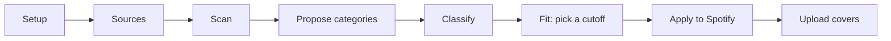

# SpotifySorter

A local Next.js app that sorts a Spotify library into mood playlists. Claude invents categories that fit the library, scores every track against them, and the app writes the result back to Spotify as private playlists.

The `ml/` folder is a separate experiment: training a small model that listens to 30-second audio previews and tries to reproduce Claude's playlist picks.

## How it works

The app runs on your own machine at `http://127.0.0.1:3000`. Its state (the scanned library, categories, scores, the Spotify refresh token) lives in one JSON file, `data/cache.json`, with Claude call logs next to it in `data/logs/`. The whole `data/` folder is gitignored.



1. **Setup** (`app/setup`, `app/api/config`). A short wizard asks for a Spotify app Client ID, an Anthropic API key and a playlist name prefix, checks the key, and writes them to `.env.local`. Sign-in uses Spotify's PKCE flow (`src/lib/spotify/pkce.ts`, `app/api/auth/login`, `app/api/auth/callback`), so no client secret is needed. The refresh token is stored in the cache and used to get a new access token when the current one is about to expire (`src/lib/spotify/client.ts`, `src/lib/spotify/refresh.ts`).

2. **Sources** (`app/scope`). You pick which playlists, plus Liked Songs, to include.

3. **Scan** (`src/lib/pipeline/scan.ts`). Reads the tracks from those playlists and the artists' genre tags from the Spotify Web API, removes duplicates, and saves them to the cache. Each playlist's `snapshot_id` and a fingerprint of Liked Songs are stored, so a rescan skips anything that has not changed. After a rescan, `app/diff` lists the new songs that still need sorting and re-reads the sources (`app/api/spotify/diff`, `src/lib/classification/diff.ts`) to point out songs that were removed from Spotify.

4. **Propose categories** (`src/lib/llm/propose.ts`). The whole library is sent to Claude Haiku as one list, one line per track with its ID, title, artist and up to three genre tags, and Claude returns 25 to 35 named categories with short descriptions and example tracks. The reply is parsed and checked against a Zod schema (`src/lib/llm/schemas.ts`); if either step fails, the call is retried once with a stricter instruction. On the Categories page (`app/review`) you can rename, merge, recolour, delete or add categories.

5. **Classify** (`src/lib/pipeline/classify.ts`, `src/lib/llm/classify.ts`). Tracks that do not have scores yet go to Claude in batches of 50, at most 3 batches at a time, at temperature 0. For each track Claude returns its top 5 categories with a 0 to 100 fit score. The request uses structured output where tracks are line numbers and categories are names, both as enums, so the model cannot invent or garble a Spotify ID. Answers that are missing, repeated or out of range are dropped and those tracks are resent, for up to 3 rounds in total. Each batch's results are written to the cache as they arrive, so a failed run keeps what it already paid for. If you add a category later, only that category is scored against the existing tracks (`src/lib/pipeline/reclassify.ts`), and the page shows a cost estimate first (`src/lib/categories/rescore-cost.ts`).

6. **Fit** (`app/classify`, `src/lib/classification/threshold.ts`). One cutoff decides membership: a track joins every category it scores at or above the cutoff, so it can land in up to five playlists. A track that clears none of them falls back to its top category. You can also move a single track by hand, which overrides its scores.

7. **Apply** (`src/lib/pipeline/apply.ts`, `src/lib/spotify/apply.ts`). Each category becomes one private playlist named `<prefix> <category>`. If the category has no playlist yet, Apply first looks for one of your own playlists with that name, and creates it only if none exists. New playlists are filled in chunks of 100 tracks (Spotify's limit per request). Existing ones are compared with the desired track set and replaced only if they differ, so Spotify always matches the app. Each write is retried after the `Retry-After` delay when Spotify rate-limits it (HTTP 429, `src/lib/spotify/retry.ts`), one chunk at a time so a retry never adds tracks twice. Apply refuses to run if two categories would produce the same playlist name. A separate "Remove playlists" action (`src/lib/spotify/library.ts`) takes the app's own playlists back out of your library.

8. **Covers** (`src/lib/sleeves/`, `src/components/graphics/sleeve-to-jpeg.ts`). Each category gets a generated record-sleeve style cover. A colour "temperature" (dusk, charge, glow or haze) is guessed from cue words in the category name (or its description, if the name has none), and you can change it on the Categories page. A random generator seeded with a hash of the category's ID and name picks the shapes and inks, so the same category always gets the same cover. The browser renders the SVG to a 640px JPEG, lowers the quality until it fits Spotify's 256 KB limit, and uploads it (`src/lib/spotify/cover.ts`).

Some pieces are shared across the steps:

- **Long jobs stream progress.** Scan, propose, classify and apply report progress to the page as server-sent events (`src/lib/pipeline/event-stream.ts`). For propose, classify and apply, `src/lib/pipeline/single-flight.ts` makes sure only one run happens at a time; a second request joins the running one instead of paying for it twice.
- **Paid or destructive routes check where the request came from.** `src/lib/http/same-origin.ts` rejects browser requests whose `Sec-Fetch-Site` header is anything other than `same-origin`, so a typed URL or another website cannot start a Claude run or wipe the categories. Requests with no such header (curl, scripts, the tests) are still allowed.
- **Safe cache writes.** `src/lib/cache/write.ts` validates the whole cache against its Zod schema, writes to a temp file and renames it, so a crash never leaves a half-written file.
- **Every Claude call is logged** with tokens, latency and cost (`src/lib/llm/log.ts`, `src/lib/llm/cost.ts`).

### Labeling page

`app/label` is a separate page for hand-labeling a sample of songs. `scripts/label-sample.ts` draws a fixed, seeded sample (`src/lib/labeling/sample.ts`) once and refuses to redraw it. The page asks two kinds of questions: which categories a song belongs in, and yes/no on single song and category pairs. The model's suggestions can be hidden, and every answer records whether they were on screen when it was given. Answers are appended to `data/labels/labels.jsonl`. The home page and the list of new songs on `app/diff` leave the sampled songs out (`src/lib/labeling/blind.ts`), so the labeler does not see them next to a category before judging them. These labels are the reference the `ml/` experiment is scored against.

### The `ml/` experiment ("Ears")

Claude only ever reads a song's title, artist and genre tags. This experiment asks whether a model that hears the audio can learn the same choices. It is a set of scripts run by hand, not part of the app.

1. **Find the recording** (`ml/fetch-isrc.ts`). Looks up each cached track's ISRC (the global ID for a recording) through the Spotify API.
2. **Find a preview** (`ml/fetch-deezer.ts`). Looks up the exact ISRC on Deezer to get a 30-second preview URL. It never matches by title, because a title search can return a sped-up or live version. A hit is rejected if Deezer echoes back a different ISRC, and flagged if its length differs from Spotify's by more than 3 seconds. `ml/coverage-report.ts` then counts how many tracks got a usable preview.
3. **Embed** (`ml/embed.py`). Streams each preview into memory, decodes it with ffmpeg through a pipe, and runs it through frozen pretrained encoders: MERT-v1-95M, MERT-v2-30s, LAION CLAP (`larger_clap_music`) and Essentia's Discogs-EffNet with its mood/theme head. Only the pooled embeddings are saved, in shards; no audio is written to disk. Each encoder gets audio at its own sample rate, and CLAP sees three fixed 10-second windows, averaged, instead of its default random crop, so results are reproducible. `ml/embed-text.py` builds a text-only baseline by running each track's title and artist through CLAP's text encoder.
4. **Merge** (`ml/merge-embeddings.py`). Combines the shards into one file, checks every array has the expected shape, and records its sha256.
5. **Build the dataset** (`ml/dataset.py`). Pairs each recording's embeddings with Claude's top-5 ranking. Only the order of the top 5 is used, not the scores. Duplicate recordings (single vs album release) are kept once, and every row carries its artist so splits can be grouped by artist.
6. **Train** (`ml/train.py`, `ml/plackett_luce.py`). A linear probe or small 2-layer network on top of the frozen embeddings, written in PyTorch. For MERT it learns a softmax weight per transformer layer instead of picking one layer by hand. The loss is Plackett-Luce, which models Claude's top 5 as an ordered ranking. Cross-validation folds are grouped by artist, including the inner early-stopping split, so the model is always tested on artists it never saw.
7. **Score** (`ml/score-gold.py`, `ml/score-pairs.py`, `ml/gold_set.py`). Compares the model and Claude against the hand labels from the labeling page. The scoring rules were written down in `ml/GOLD-PROTOCOL.md` before scoring, and `score-gold.py --freeze` stores a hash of that file in `ml/gold-config.json`; scoring refuses to run if the protocol was edited afterward.

`ml/bench/` checks the embedding pipeline itself by reproducing a linear probe on the public MTG-Jamendo mood/theme dataset and comparing MERT-v1 with MERT-v2 under the same setup.

## Project layout

```
app/              Next.js pages (setup, scope, scan, review, classify, diff, apply, label) and API routes
src/lib/
  pipeline/       scan, propose, classify, reclassify and apply jobs, plus streaming and single-flight
  llm/            Claude prompts, structured output, response parsing, cost and logging
  spotify/        PKCE auth, token refresh, paging, retries, playlist reads and writes, cover upload
  cache/          Zod schema and atomic read/write for data/cache.json
  classification/ cutoff rule, manual overrides, library diff
  sleeves/        generated cover art (palette, shapes, seeded randomness, SVG)
  labeling/       sample drawing and storage for the labeling page
src/components/   React UI, grouped by page
scripts/          one-off tsx scripts (full-library classify, category merges, label sample, batch-neighbor test, run and cost audits)
ml/               audio embedding and training experiment (Python, plus three tsx scripts for fetching and coverage)
tests/            Vitest unit and integration tests, Playwright end-to-end tests with a mock server
docs/             UI design notes and a manual test walkthrough
```

## Tech stack

- Next.js (App Router), React 19, TypeScript, Tailwind CSS 4, Framer Motion, dnd-kit
- Anthropic TypeScript SDK (Claude Haiku 4.5)
- Spotify Web API (PKCE OAuth)
- Zod for validating the cache, env and model replies
- Vitest, Testing Library, MSW and Playwright for tests
- `ml/`: Python 3.12, PyTorch, Hugging Face Transformers (MERT, CLAP), Essentia TensorFlow, NumPy, scikit-learn, ffmpeg, uv

## Running it

Requires Node 24 (see `.nvmrc`) and pnpm.

```bash
pnpm install
pnpm start:open   # next dev on http://127.0.0.1:3000, then opens the browser
```

The home page's **Set up** button walks through creating a Spotify developer app (redirect URI `http://127.0.0.1:3000/api/auth/callback`), then asks for its Client ID, an Anthropic API key and a playlist prefix, and writes the keys to `.env.local`. The variables are `SPOTIFY_CLIENT_ID` and `ANTHROPIC_API_KEY`; see `.env.local.example`. Use `127.0.0.1`, not `localhost`, because Spotify sign-in is tied to that address.

Tests:

```bash
pnpm test         # vitest, uses a temp data dir and no network
pnpm typecheck
pnpm lint
pnpm test:e2e     # Playwright against a production build and a local mock of Spotify and Anthropic
```

The `ml/` scripts need their own Python environment:

```bash
bash ml/setup-env.sh   # creates ml/venv with uv and checks that torch and essentia load together
```

They read `data/cache.json`, so they only work after the app has scanned and classified a library. Outputs go to `ml/artifacts/`, which is gitignored.
